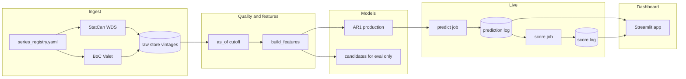

# ca-nowcaster

A live, self-scoring nowcast of Canada's monthly real GDP growth (month-over-month
at basic prices). Faster public series from Statistics Canada and the Bank of Canada
arrive before the official GDP print; the pipeline builds leakage-safe features,
predicts before the release, then scores itself when the number lands.

**Result (honest):** On the Phase 3 walk-forward panel, no regression candidate beat
the AR(1) baseline on headline RMSE with Diebold-Mariano significance and bootstrap
CI support — so v1 ships AR(1) as the production model and treats that outcome as the
lesson, not a failure. Full verdicts: [`docs/evaluation_report.md`](docs/evaluation_report.md).

## Architecture



ASCII (same flow):

```
StatCan / BoC → vintage raw store → as_of → features
        → AR(1) predict → prediction log → score log → Streamlit
Candidates run only through evaluation (not production).
```

## How to run

Python 3.11+. No API keys for v1 public endpoints.

```bash
python -m venv .venv
source .venv/bin/activate
pip install -e ".[dev]"

# Refresh verified series into the raw store
nowcaster-ingest-refresh

# Live dry-run (fixture-friendly; see docs/live_pipeline.md)
nowcaster-live dry-run --help

# Dashboard (reads stored logs, or bundled fixtures if empty)
streamlit run streamlit_app.py

# Tests / phase gates
pytest tests/gates/
```

Copy [`.env.example`](.env.example) to `.env` for local paths. Scheduled predict/score
jobs: [`.github/workflows/live-predict.yml`](.github/workflows/live-predict.yml) and
[`live-score.yml`](.github/workflows/live-score.yml).

### Public dashboard (human step)

Streamlit Community Cloud deploy is a one-time human action — agents cannot finish it.
Tap-by-tap: [`docs/streamlit_deploy.md`](docs/streamlit_deploy.md). Paste the public URL
into `STATE.md` when live. Until then, run locally with `streamlit run streamlit_app.py`.

## What shipped

| Piece | Where |
|-------|--------|
| Shared contracts | `src/nowcaster/contracts.py` |
| Series registry (verified IDs) | `series_registry.yaml` |
| Ingest / quality / features | `src/nowcaster/ingest/`, `quality/`, `features/` |
| Baselines + candidates | `src/nowcaster/models/` · docs under `docs/models/` |
| Evaluation report (honest) | `docs/evaluation_report.md` |
| Live self-scoring | `src/nowcaster/live/` · `docs/live_pipeline.md` |
| Dashboard | `src/nowcaster/app/` · `streamlit_app.py` |
| Model card | [`docs/model_card.md`](docs/model_card.md) |
| Interview notes + resume bullets | [`docs/interview_notes.md`](docs/interview_notes.md) |
| Security / failure modes | `docs/security_review.md`, `docs/failure_modes.md` |

**Production model:** `ar1` @ `0.1.0` (see `docs/live_pipeline.md`).

## Limits

- Evaluation headline numbers in `docs/evaluation_report.md` are from a **synthetic**
  monthly panel (2015-01..2022-12), not a claim of live StatCan skill.
- No candidate cleared the skeptic bar vs AR(1); richer models are research, not production.
- Official GDP revises; vintages are append-only, but revision analysis is not v1 scope.
- Dashboard has no public Cloud URL until a human deploys Community Cloud.
- Out of scope: deep learning, paid data, accounts, trading/betting, regional splits
  (ideas go in `BACKLOG.md` only).

## Agent rules

See [`AGENTS.md`](AGENTS.md). Project status: [`STATE.md`](STATE.md). Phase gates:
[`docs/gates.md`](docs/gates.md).
