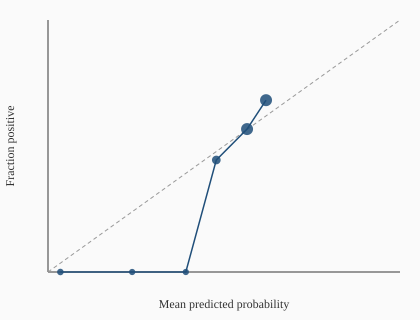

# Evaluation report (Phase 3)

Owned by the **Evaluation Skeptic**. Plain-language verdicts first;
tables second. Honest-result rule: if nothing beats the baseline, say so.

**Panel:** synthetic monthly panel (2010-01..2022-12; holdout final 24 months locked; COVID headline exclusion 2020-03..2020-08). Not live StatCan — live refresh + final candidates will replace these numbers.
**Reference baseline:** `ar1`
**Holdout:** LOCKED — holdout not burned. Final candidate model versions are not registered yet; Evaluation will touch holdout once per final version.

## Loud verdict

HONEST RESULT: No Phase 3 candidate models are registered. Nothing has beaten the baselines because nothing beyond last_value / ar1 / rolling_mean has been submitted for evaluation. See docs/requests/modeling-phase3-candidate-registration.md.

## Candidate registration

- Expected: `bridge, dynamic_factor, gradient_boosting, direction_classifier`
- Registered: `(none)`
- Missing: `bridge, dynamic_factor, gradient_boosting, direction_classifier`

## Walk-forward metrics (expanding window, holdout excluded)

Headline metrics **exclude** COVID shock months (2020-03..2020-08).
Full-sample metrics include them. Ratios are candidate / reference (`ar1`); **ratio < 1 is better**.

| Model | Role | Version | Headline n | Headline RMSE | Full RMSE | RMSE ratio | MAE ratio | Dir. acc. | Cov80 | Cov95 | Beats ref? |
|-------|------|---------|------------|---------------|-----------|------------|-----------|-----------|-------|-------|------------|
| `last_value` | baseline | 0.1.0 | 102 | 0.3851 | 0.4162 | 1.0558 | 1.1667 | 0.608 | 0.794 | 0.941 | no |
| `ar1` | baseline | 0.1.0 | 102 | 0.3648 | 0.4549 | 1.0000 | 1.0000 | 0.608 | 0.843 | 0.931 | no |
| `rolling_mean` | baseline | 0.1.0 | 102 | 0.4022 | 0.4651 | 1.1025 | 1.2092 | 0.578 | 0.775 | 0.951 | no |

## Per-model verdicts

### `last_value` (baseline)

last_value@0.1.0 DOES NOT BEAT reference ar1: RMSE ratio 1.0558 is not below 1 (no improvement).

- Diebold-Mariano vs `ar1`: stat=1.493, p=0.1355, mean SE diff=0.015270, n=102
- Bootstrap RMSE-ratio CI (95%, 500 draws): point=1.0558, [0.9894, 1.3664]

### `ar1` (baseline)

ar1 is the reference baseline (headline RMSE=0.3648, n=102). It does not 'beat' itself.

- Diebold-Mariano vs `ar1`: stat=0.000, p=1.0000, mean SE diff=0.000000, n=102
- Bootstrap RMSE-ratio CI (95%, 500 draws): point=1.0000, [1.0000, 1.0000]

### `rolling_mean` (baseline)

rolling_mean@0.1.0 DOES NOT BEAT reference ar1: RMSE ratio 1.1025 is not below 1 (no improvement).

- Diebold-Mariano vs `ar1`: stat=0.458, p=0.6473, mean SE diff=0.028682, n=102
- Bootstrap RMSE-ratio CI (95%, 500 draws): point=1.1025, [0.8228, 2.1499]

## Direction classifier metrics

### `last_value` (sign of point forecast as class)

- n=102, accuracy=0.6078431372549019, precision=0.6491228070175439, recall=0.6491228070175439, F1=0.6491228070175439
- Confusion matrix `[[TN, FP], [FN, TP]]` = `[[25, 20], [20, 37]]`
- Calibration bins (mean predicted → fraction positive):

| Bin | n | Mean p | Fraction + |
|-----|---|--------|------------|
| [0.0, 0.1] | 2 | 0.018 | 0.000 |
| [0.1, 0.2] | 8 | 0.163 | 0.250 |
| [0.2, 0.3] | 8 | 0.243 | 0.625 |
| [0.3, 0.4] | 10 | 0.356 | 0.400 |
| [0.4, 0.5] | 17 | 0.430 | 0.529 |
| [0.5, 0.6] | 14 | 0.553 | 0.357 |
| [0.6, 0.7] | 16 | 0.647 | 0.750 |
| [0.7, 0.8] | 20 | 0.750 | 0.700 |
| [0.8, 0.9] | 5 | 0.845 | 0.800 |
| [0.9, 1.0] | 2 | 0.932 | 1.000 |

### `ar1` (sign of point forecast as class)

- n=102, accuracy=0.6078431372549019, precision=0.5955056179775281, recall=0.9298245614035088, F1=0.726027397260274
- Confusion matrix `[[TN, FP], [FN, TP]]` = `[[9, 36], [4, 53]]`
- Calibration bins (mean predicted → fraction positive):

| Bin | n | Mean p | Fraction + |
|-----|---|--------|------------|
| [0.0, 0.1] | 2 | 0.035 | 0.000 |
| [0.2, 0.3] | 1 | 0.239 | 0.000 |
| [0.3, 0.4] | 1 | 0.392 | 0.000 |
| [0.4, 0.5] | 9 | 0.478 | 0.444 |
| [0.5, 0.6] | 67 | 0.565 | 0.567 |
| [0.6, 0.7] | 22 | 0.619 | 0.682 |

### `rolling_mean` (sign of point forecast as class)

- n=102, accuracy=0.5784313725490197, precision=0.609375, recall=0.6842105263157895, F1=0.6446280991735538
- Confusion matrix `[[TN, FP], [FN, TP]]` = `[[20, 25], [18, 39]]`
- Calibration bins (mean predicted → fraction positive):

| Bin | n | Mean p | Fraction + |
|-----|---|--------|------------|
| [0.0, 0.1] | 3 | 0.000 | 0.000 |
| [0.1, 0.2] | 3 | 0.155 | 0.333 |
| [0.2, 0.3] | 2 | 0.227 | 0.500 |
| [0.3, 0.4] | 15 | 0.356 | 0.467 |
| [0.4, 0.5] | 15 | 0.444 | 0.600 |
| [0.5, 0.6] | 22 | 0.547 | 0.591 |
| [0.6, 0.7] | 25 | 0.644 | 0.680 |
| [0.7, 0.8] | 15 | 0.731 | 0.533 |
| [0.8, 0.9] | 2 | 0.819 | 0.500 |

## Calibration plot

## Leakage audits

Shuffled-target skill that does **not** collapse (ratio << 1) is a red flag: either the sample is too small for stable RMSE, or the harness is leaking. Feature-timing scramble must collapse skill for feature-using models.

### baselines

- **shuffled_targets**: PASS — shuffled/reference headline RMSE ratio=1.4569; shuffled dir_acc=0.451 (pass if ratio>=0.95 OR dir_acc<=0.6)
- **feature_timing_randomize**: PASS — model declared feature-blind; feature-row scramble cannot collapse skill — rely on shuffled_targets audit
- **timing_randomize**: PASS — timing-randomize hook executed with jittered as_of map only; pair with feature_rebuild=... for a strict leakage collapse test; rmse_ratio_vs_reference=1.0000

## How I could be wrong

- Synthetic / fixture panels can overstate or understate real StatCan skill.
- Diebold-Mariano assumes loss differentials are covariance-stationary; COVID and policy regime shifts may violate that.
- Bootstrap of OOS residuals ignores estimation uncertainty (no re-fit).
- Sign(point) is a weak stand-in for a trained direction classifier.
- Feature-blind baselines cannot fail the feature-timing scramble; that audit only bites once Modeling registers feature-using candidates.
- Holdout is still locked; out-of-sample optimism in the train/eval pool may reverse on the final 24 months.

## Coordination

- Modeling must register final candidates via `list_candidates` / `create_candidate` (see `docs/requests/modeling-phase3-candidate-registration.md`).
- After final versions land, Evaluation will unlock holdout **once per version**, append `docs/holdout_log.md`, and refresh this report.

