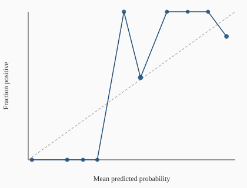

# Evaluation report (Phase 3)

Owned by the **Evaluation Skeptic**. Plain-language verdicts first;
tables second. Honest-result rule: if nothing beats the baseline, say so.

**Panel:** synthetic monthly panel (2015-01..2022-12; holdout final 24 months burned once per candidate@0.1.0; COVID headline exclusion 2020-03..2020-08). Not live StatCan.
**Reference baseline:** `ar1`
**Holdout:** BURNED once per final candidate (name, version=0.1.0) on synthetic panel — see docs/holdout_log.md. Live StatCan refresh requires a version bump to re-score.

## Loud verdict

HONEST RESULT: No regression candidate beats the reference baseline (ar1) on headline RMSE with Diebold-Mariano and bootstrap CI support. Direction models are scored separately (classifier metrics only). v1 still ships under the honest-result rule.

## Candidate registration

- Expected: `bridge, dynamic_factor, gradient_boosting, direction_classifier, direction_boosting`
- Registered: `bridge, direction_boosting, direction_classifier, dynamic_factor, gradient_boosting`
- Missing: `(none)`

## Walk-forward metrics (expanding window, holdout excluded)

Headline metrics **exclude** COVID shock months (2020-03..2020-08).
Full-sample metrics include them. Ratios are candidate / reference (`ar1`); **ratio < 1 is better**.

| Model | Role | Version | Headline n | Headline RMSE | Full RMSE | RMSE ratio | MAE ratio | Dir. acc. | Cov80 | Cov95 | Beats ref? |
|-------|------|---------|------------|---------------|-----------|------------|-----------|-----------|-------|-------|------------|
| `last_value` | baseline | 0.1.0 | 42 | 0.5642 | 0.5794 | 0.9601 | 1.0801 | 0.690 | 0.786 | 0.881 | no |
| `ar1` | baseline | 0.1.0 | 42 | 0.5876 | 0.6613 | 1.0000 | 1.0000 | 0.643 | 0.857 | 0.905 | no |
| `rolling_mean` | baseline | 0.1.0 | 42 | 0.6174 | 0.6883 | 1.0507 | 1.2960 | 0.595 | 0.738 | 0.905 | no |
| `bridge` | candidate | 0.1.0 | 42 | 0.0652 | 0.0777 | 0.1110 | 0.2004 | 0.976 | 0.762 | 0.857 | no |
| `dynamic_factor` | candidate | 0.1.0 | 42 | 0.7193 | 0.7270 | 1.2242 | 1.2509 | 0.643 | 0.786 | 0.857 | no |
| `gradient_boosting` | candidate | 0.1.0 | 42 | 0.2578 | 0.7415 | 0.4388 | 0.6382 | 0.857 | 0.905 | 0.976 | no |
| `direction_classifier` | direction_candidate | 0.1.0 | 42 | n/a | n/a | n/a | n/a | 0.548 | 0.357 | 0.405 | n/a |
| `direction_boosting` | direction_candidate | 0.1.0 | 42 | n/a | n/a | n/a | n/a | 0.548 | 0.548 | 0.548 | n/a |

## Per-model verdicts

### `last_value` (baseline)

last_value@0.1.0 DOES NOT BEAT reference ar1: RMSE ratio point estimate 0.9601 < 1 but 95% bootstrap CI upper 1.5141 includes/exceeds 1 — not a clear win.

- Diebold-Mariano vs `ar1`: stat=-0.490, p=0.6240, mean SE diff=-0.026993, n=42
- Bootstrap RMSE-ratio CI (95%, 300 draws): point=0.9601, [0.9186, 1.5141]

### `ar1` (baseline)

ar1 is the reference baseline (headline RMSE=0.5876, n=42). It does not 'beat' itself.

- Diebold-Mariano vs `ar1`: stat=0.000, p=1.0000, mean SE diff=0.000000, n=42
- Bootstrap RMSE-ratio CI (95%, 300 draws): point=1.0000, [1.0000, 1.0000]

### `rolling_mean` (baseline)

rolling_mean@0.1.0 DOES NOT BEAT reference ar1: RMSE ratio 1.0507 is not below 1 (no improvement).

- Diebold-Mariano vs `ar1`: stat=0.203, p=0.8392, mean SE diff=0.035931, n=42
- Bootstrap RMSE-ratio CI (95%, 300 draws): point=1.0507, [0.7987, 3.4163]

### `bridge` (candidate)

bridge@0.1.0 DOES NOT BEAT reference ar1: RMSE improved in point estimate but Diebold-Mariano does not reject equal accuracy at alpha=0.05 (DM=-1.117, p=0.2641, mean SE diff=-0.341038).

- Diebold-Mariano vs `ar1`: stat=-1.117, p=0.2641, mean SE diff=-0.341038, n=42
- Bootstrap RMSE-ratio CI (95%, 300 draws): point=0.1110, [0.0768, 0.3375]

### `dynamic_factor` (candidate)

dynamic_factor@0.1.0 DOES NOT BEAT reference ar1: RMSE ratio 1.2242 is not below 1 (no improvement).

- Diebold-Mariano vs `ar1`: stat=1.459, p=0.1446, mean SE diff=0.172154, n=42
- Bootstrap RMSE-ratio CI (95%, 300 draws): point=1.2242, [1.0296, 2.6901]

### `gradient_boosting` (candidate)

gradient_boosting@0.1.0 DOES NOT BEAT reference ar1: RMSE ratio point estimate 0.4388 < 1 but 95% bootstrap CI upper 1.5349 includes/exceeds 1 — not a clear win.

- Diebold-Mariano vs `ar1`: stat=-0.963, p=0.3357, mean SE diff=-0.278821, n=42
- Bootstrap RMSE-ratio CI (95%, 300 draws): point=0.4388, [0.3055, 1.5349]

### `direction_classifier` (direction_candidate)

direction_classifier@0.1.0 is a direction classifier (point = P(beat previous)). Not scored on GDP MoM RMSE vs AR(1). Headline accuracy=0.7804878048780488, F1=0.8.

### `direction_boosting` (direction_candidate)

direction_boosting@0.1.0 is a direction classifier (point = P(beat previous)). Not scored on GDP MoM RMSE vs AR(1). Headline accuracy=0.3170731707317073, F1=0.3333333333333333.

## Direction classifier metrics

### `last_value` (sign of point forecast as class)

- n=42, accuracy=0.6904761904761905, precision=0.7083333333333334, recall=0.7391304347826086, F1=0.723404255319149
- Confusion matrix `[[TN, FP], [FN, TP]]` = `[[12, 7], [6, 17]]`
- Calibration bins (mean predicted → fraction positive):

| Bin | n | Mean p | Fraction + |
|-----|---|--------|------------|
| [0.0, 0.1] | 1 | 0.000 | 0.000 |
| [0.1, 0.2] | 2 | 0.180 | 0.000 |
| [0.2, 0.3] | 3 | 0.234 | 0.333 |
| [0.3, 0.4] | 5 | 0.350 | 0.600 |
| [0.4, 0.5] | 7 | 0.431 | 0.286 |
| [0.5, 0.6] | 3 | 0.573 | 0.000 |
| [0.6, 0.7] | 7 | 0.649 | 1.000 |
| [0.7, 0.8] | 10 | 0.743 | 0.700 |
| [0.8, 0.9] | 3 | 0.851 | 0.667 |
| [0.9, 1.0] | 1 | 0.955 | 1.000 |

### `ar1` (sign of point forecast as class)

- n=42, accuracy=0.6428571428571429, precision=0.6052631578947368, recall=1.0, F1=0.7540983606557378
- Confusion matrix `[[TN, FP], [FN, TP]]` = `[[4, 15], [0, 23]]`
- Calibration bins (mean predicted → fraction positive):

| Bin | n | Mean p | Fraction + |
|-----|---|--------|------------|
| [0.0, 0.1] | 1 | 0.000 | 0.000 |
| [0.2, 0.3] | 2 | 0.224 | 0.000 |
| [0.4, 0.5] | 1 | 0.418 | 0.000 |
| [0.5, 0.6] | 26 | 0.572 | 0.577 |
| [0.6, 0.7] | 12 | 0.624 | 0.667 |

### `rolling_mean` (sign of point forecast as class)

- n=42, accuracy=0.5952380952380952, precision=0.6071428571428571, recall=0.7391304347826086, F1=0.6666666666666666
- Confusion matrix `[[TN, FP], [FN, TP]]` = `[[8, 11], [6, 17]]`
- Calibration bins (mean predicted → fraction positive):

| Bin | n | Mean p | Fraction + |
|-----|---|--------|------------|
| [0.0, 0.1] | 3 | 0.001 | 0.000 |
| [0.2, 0.3] | 1 | 0.276 | 0.000 |
| [0.3, 0.4] | 3 | 0.371 | 0.333 |
| [0.4, 0.5] | 7 | 0.444 | 0.714 |
| [0.5, 0.6] | 4 | 0.553 | 0.750 |
| [0.6, 0.7] | 14 | 0.645 | 0.643 |
| [0.7, 0.8] | 8 | 0.728 | 0.500 |
| [0.8, 0.9] | 2 | 0.819 | 0.500 |

### `bridge` (sign of point forecast as class)

- n=42, accuracy=0.9761904761904762, precision=0.9583333333333334, recall=1.0, F1=0.9787234042553191
- Confusion matrix `[[TN, FP], [FN, TP]]` = `[[18, 1], [0, 23]]`
- Calibration bins (mean predicted → fraction positive):

| Bin | n | Mean p | Fraction + |
|-----|---|--------|------------|
| [0.0, 0.1] | 1 | 0.086 | 0.000 |
| [0.2, 0.3] | 4 | 0.248 | 0.000 |
| [0.3, 0.4] | 5 | 0.350 | 0.000 |
| [0.4, 0.5] | 8 | 0.441 | 0.000 |
| [0.5, 0.6] | 3 | 0.546 | 0.667 |
| [0.6, 0.7] | 10 | 0.659 | 1.000 |
| [0.7, 0.8] | 8 | 0.745 | 1.000 |
| [0.8, 0.9] | 2 | 0.837 | 1.000 |
| [0.9, 1.0] | 1 | 0.928 | 1.000 |

### `dynamic_factor` (sign of point forecast as class)

- n=42, accuracy=0.6428571428571429, precision=0.6176470588235294, recall=0.9130434782608695, F1=0.7368421052631579
- Confusion matrix `[[TN, FP], [FN, TP]]` = `[[6, 13], [2, 21]]`
- Calibration bins (mean predicted → fraction positive):

| Bin | n | Mean p | Fraction + |
|-----|---|--------|------------|
| [0.0, 0.1] | 2 | 0.000 | 0.000 |
| [0.2, 0.3] | 1 | 0.298 | 0.000 |
| [0.3, 0.4] | 1 | 0.334 | 0.000 |
| [0.4, 0.5] | 4 | 0.483 | 0.500 |
| [0.5, 0.6] | 19 | 0.556 | 0.684 |
| [0.6, 0.7] | 15 | 0.645 | 0.533 |

### `gradient_boosting` (sign of point forecast as class)

- n=42, accuracy=0.8571428571428571, precision=0.7931034482758621, recall=1.0, F1=0.8846153846153846
- Confusion matrix `[[TN, FP], [FN, TP]]` = `[[13, 6], [0, 23]]`
- Calibration bins (mean predicted → fraction positive):

| Bin | n | Mean p | Fraction + |
|-----|---|--------|------------|
| [0.0, 0.1] | 4 | 0.025 | 0.000 |
| [0.3, 0.4] | 9 | 0.358 | 0.000 |
| [0.5, 0.6] | 16 | 0.581 | 0.625 |
| [0.6, 0.7] | 4 | 0.638 | 1.000 |
| [0.7, 0.8] | 9 | 0.778 | 1.000 |

### `direction_classifier` (sign of point forecast as class)

- n=41, accuracy=0.7804878048780488, precision=0.782608695652174, recall=0.8181818181818182, F1=0.8
- Confusion matrix `[[TN, FP], [FN, TP]]` = `[[14, 5], [4, 18]]`
- Calibration bins (mean predicted → fraction positive):

| Bin | n | Mean p | Fraction + |
|-----|---|--------|------------|
| [0.0, 0.1] | 4 | 0.018 | 0.000 |
| [0.1, 0.2] | 4 | 0.188 | 0.000 |
| [0.2, 0.3] | 3 | 0.265 | 0.000 |
| [0.3, 0.4] | 3 | 0.333 | 0.000 |
| [0.4, 0.5] | 4 | 0.462 | 1.000 |
| [0.5, 0.6] | 9 | 0.542 | 0.556 |
| [0.6, 0.7] | 3 | 0.670 | 1.000 |
| [0.7, 0.8] | 2 | 0.770 | 1.000 |
| [0.8, 0.9] | 3 | 0.869 | 1.000 |
| [0.9, 1.0] | 6 | 0.958 | 0.833 |

### `direction_boosting` (sign of point forecast as class)

- n=41, accuracy=0.3170731707317073, precision=0.35, recall=0.3181818181818182, F1=0.3333333333333333
- Confusion matrix `[[TN, FP], [FN, TP]]` = `[[6, 13], [15, 7]]`
- Calibration bins (mean predicted → fraction positive):

| Bin | n | Mean p | Fraction + |
|-----|---|--------|------------|
| [0.2, 0.3] | 3 | 0.283 | 0.667 |
| [0.3, 0.4] | 1 | 0.319 | 0.000 |
| [0.4, 0.5] | 17 | 0.477 | 0.765 |
| [0.5, 0.6] | 20 | 0.505 | 0.350 |

## Calibration plot

## Leakage audits

Shuffled-target skill that does **not** collapse (ratio << 1) is a red flag: either the sample is too small for stable RMSE, or the harness is leaking. Feature-timing scramble must collapse skill for feature-using models.

### baselines

- **shuffled_targets**: PASS — shuffled/reference headline RMSE ratio=0.9256; shuffled dir_acc=0.500 (pass if ratio>=0.95 OR dir_acc<=0.6)
- **feature_timing_randomize**: PASS — model declared feature-blind; feature-row scramble cannot collapse skill — rely on shuffled_targets audit
- **timing_randomize**: PASS — timing-randomize hook executed with jittered as_of map only; pair with feature_rebuild=... for a strict leakage collapse test; rmse_ratio_vs_reference=1.0000

### Candidate `bridge`

- **shuffled_targets**: PASS — shuffled/reference headline RMSE ratio=8.1843; shuffled dir_acc=0.500 (pass if ratio>=0.95 OR dir_acc<=0.6)
- **feature_timing_randomize**: PASS — scrambled-features/reference headline RMSE ratio=2.8973 (pass if >= 0.95; feature skill should collapse)
- **timing_randomize**: PASS — timing-randomize hook executed with jittered as_of map only; pair with feature_rebuild=... for a strict leakage collapse test; rmse_ratio_vs_reference=1.0000

## How I could be wrong

- Synthetic / fixture panels can overstate or understate real StatCan skill.
- Diebold-Mariano assumes loss differentials are covariance-stationary; COVID and policy regime shifts may violate that.
- Bootstrap of OOS residuals ignores estimation uncertainty (no re-fit).
- Sign(point) is a weak stand-in for a trained direction classifier.
- Feature-blind baselines cannot fail the feature-timing scramble; that audit only bites once Modeling registers feature-using candidates.
- Holdout is still locked; out-of-sample optimism in the train/eval pool may reverse on the final 24 months.

## Coordination

- Modeling must register final candidates via `list_candidates` / `create_candidate` (see `docs/requests/modeling-phase3-candidate-registration.md`).
- After final versions land, Evaluation will unlock holdout **once per version**, append `docs/holdout_log.md`, and refresh this report.

## Holdout scores (once per final version)

Synthetic-panel holdout (final 24 months). One unlock per `(name, version)` via `evaluate_holdout_once`.

| Model@version | Notes |
|---------------|-------|
| `bridge@0.1.0` | n=24 rmse=0.0467 dir_acc=1.0 |
| `dynamic_factor@0.1.0` | n=24 rmse=0.1641 dir_acc=0.6666666666666666 |
| `gradient_boosting@0.1.0` | n=24 rmse=0.3361 dir_acc=0.75 |
| `direction_classifier@0.1.0` | n=24 rmse=0.5804 dir_acc=0.5833333333333334 |
| `direction_boosting@0.1.0` | n=24 rmse=0.5407 dir_acc=0.5833333333333334 |

